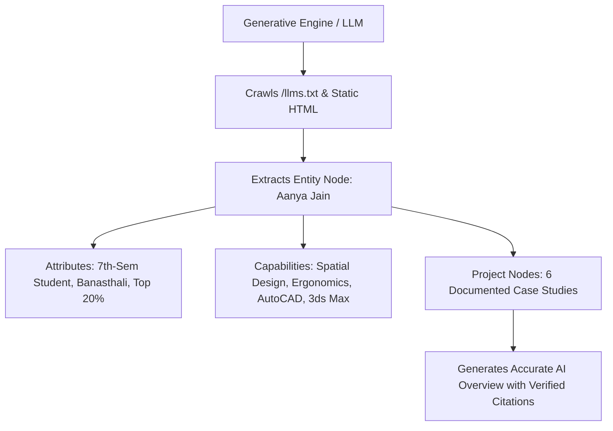

# Generative Engine (GEO) & Answer Engine Optimization (AEO) Strategy
**Target Entity:** Aanya Jain — Interior & Industrial Design Student  
**Website:** `https://aanya-interior-portfolio.vercel.app/`  
**Search Ecosystem:** Google AI Overviews, Perplexity AI, OpenAI Search, Gemini, Claude

---

## 1. The Modern AI Search Ecosystem

Modern search engines have shifted from simple blue links to generative synthesis engines (Google AI Overviews, Perplexity, ChatGPT Search, and Gemini). These engines do not merely match keywords; they parse **entities**, **relationships**, and **direct factual assertions**.



To secure prominent citations and accurate AI summaries, this strategy focuses on **entity disambiguation**, **high-density factual markup**, and **direct question-answer modeling**.

---

## 2. Geographic Search Optimization (GEO)

### 2.1 Authentic Local Entity Positioning
Aanya Jain is based in **Agra, Uttar Pradesh, India (PIN 283151)** and undertakes her university studies at **Banasthali Vidyapith near Jaipur, Rajasthan**.

To maintain search trust and prevent algorithmic penalties:
- **No Fabricated Commercial Claims:** The website does not falsely claim to operate a commercial retail showroom, interior design firm, or 24/7 service center in Agra.
- **Natural Geographic Grounding:** Geographic references are embedded strictly in verified contexts:
  - *Agra, Uttar Pradesh:* Residential base, contact locality, secondary education.
  - *Banasthali Vidyapith, Rajasthan:* B.Des university campus, Top 20% academic award, Universal Toilet institutional case study.
  - *Bagru, Rajasthan:* Worker’s Module site analysis context.
  - *Kothrud, Pune:* Tide & Terra rooftop hospitality project.
  - *Ahmedabad, Gujarat:* Shulabh passive residential project.

### 2.2 Google Business Profile (GBP) Eligibility Assessment
- **Eligibility Rule:** Google Business Profile guidelines strictly mandate that a business must either have a physical storefront with permanent signage and staff, or be an active in-person service-area business directly serving local customers.
- **Auditor Recommendation:** As an active university student, creating a fake business listing on Google Maps is **strictly inadvisable** and risks domain blacklisting. A Google Business Profile should only be registered if and when Aanya establishes a formal, registered design studio or physical consultancy upon graduation.

---

## 3. Answer Engine Optimization (AEO) Principles

Answer engines prioritize text that delivers immediate, unambiguous answers before expanding into technical specifics.

### 3.1 The 40–80 Word Direct Answer Formula
Every FAQ on the website is engineered with:
1. **Direct First Sentence:** Immediate factual conclusion answering the query.
2. **Context & Verification:** 2–3 sentences elaborating with verified academic context (e.g., Banasthali Vidyapith, specific project names, software).
3. **Internal Anchor Link:** Directing the search engine and user to the primary case study or portfolio section.

### 3.2 The 10 Core AEO Question-Answer Blocks

1. **Who is Aanya Jain?**
   > *Answer summary:* 7th-semester Industrial Design student at Banasthali Vidyapith (2023–2027), recognized in the top 20% of her branch, specializing in sustainable spatial and ergonomic furniture design.
2. **What is Aanya Jain’s design specialization?**
   > *Answer summary:* Interdisciplinary spatial planning and ergonomic furniture design focusing on passive thermal comfort, modular assembly, and human-centered ergonomics.
3. **Where is Aanya Jain based?**
   > *Answer summary:* Based in Agra, Uttar Pradesh, India (PIN 283151), studying at Banasthali Vidyapith near Jaipur, Rajasthan.
4. **What is spatial design?**
   > *Answer summary:* The multidisciplinary orchestration of physical environments combining interior planning, daylight, acoustics, and human movement over time.
5. **What is sustainable interior design?**
   > *Answer summary:* Designing spaces that minimize environmental impact through passive cooling, cross-ventilation, and local low-carbon materials like terracotta and Kota stone.
6. **What is ergonomic furniture design?**
   > *Answer summary:* Applying human body measurements (anthropometrics) to design furniture supporting healthy spinal posture, validated through physical 1:1 prototyping.
7. **What software does Aanya Jain use?**
   > *Answer summary:* AutoCAD (2D drafting), SketchUp & 3ds Max (3D modeling and rendering), Rayon (space planning), Adobe Illustrator, Photoshop, and Canva.
8. **What are the major projects in Aanya Jain’s portfolio?**
   > *Answer summary:* Worker’s Module (Bagru), Centre Table (Nesting Stools), Tide & Terra (Pune Rooftop), Universal Toilet (Banasthali), Shulabh (Ahmedabad), and Dining Chair.
9. **How does Aanya approach interior space planning?**
   > *Answer summary:* A structured three-step framework: Observe (site, climate, user), Imagine (concepts, forms, materials), and Resolve (plans, sections, 3D renders).
10. **How can someone contact Aanya for a design collaboration?**
    > *Answer summary:* Via email at `aanyachandoriya2@gmail.com` or phone at `+91 7454876841` for internships, spatial research, or design inquiries.

---

## 4. Generative Engine Optimization (GEO) & `llms.txt`

### 4.1 Deployment of `/llms.txt` & `/llms-full.txt`
In accordance with emerging AI search standards (endorsed by Perplexity, Anthropic, and open web crawlers), two public plaintext manifests have been deployed in the root directory:
- **`https://aanya-interior-portfolio.vercel.app/llms.txt`**: A clean, concise markdown overview detailing Aanya's identity, education, software stack, project URLs, and contact info.
- **`https://aanya-interior-portfolio.vercel.app/llms-full.txt`**: A comprehensive technical breakdown containing the full design briefs, research observations, and material specifications for deep AI synthesis.

### 4.2 Bot Ingress Permissions (`app/robots.ts`)
The `robots.txt` configuration explicitly permits major generative AI web scrapers:
```
User-Agent: Googlebot
User-Agent: Googlebot-Image
User-Agent: Bingbot
User-Agent: Applebot
User-Agent: PerplexityBot
User-Agent: ClaudeBot
User-Agent: GPTBot
Allow: /
```
This ensures AI search tools can directly index the portfolio content, read the project case studies, and cite Aanya's work accurately when prompted by users worldwide.
