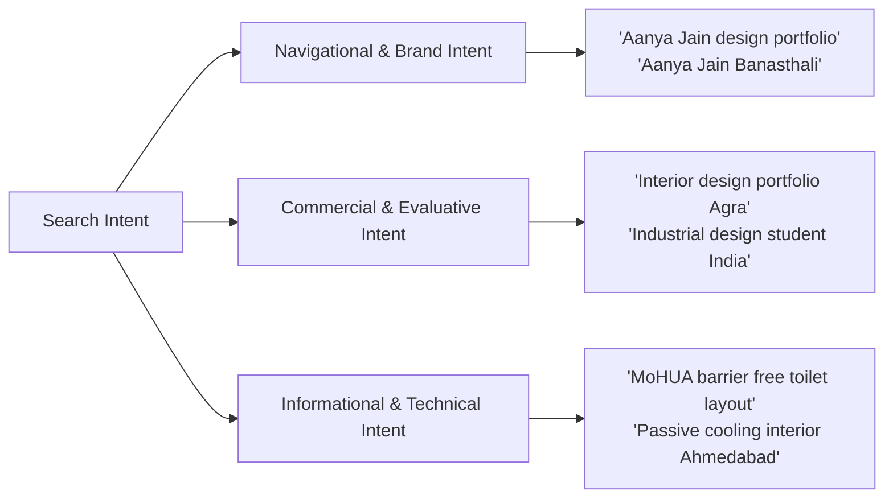

# Strategic Keyword Universe & Intent Mapping
**Entity:** Aanya Jain | Interior & Industrial Design Portfolio  
**Domain:** `https://aanya-interior-portfolio.vercel.app/`  
**Purpose:** Search Intent Capture, Entity Disambiguation, and Topical Authority Architecture  

---

## 1. Search Intent & Audience Analysis

To generate genuine internships, academic research fellowships, and design collaboration inquiries, the portfolio targets three distinct search intents:

1. **Navigational & Brand Search (High Conversion):** Recruiters, design firms, or academic mentors searching specifically for Aanya Jain or verifying her qualifications after reviewing her resume or social channels.
2. **Commercial & Talent Evaluative Search (Internships & Projects):** Design studios looking for interior design interns, industrial design students, or spatial visualizers in India (specifically North/Western India, Agra, Jaipur, Delhi NCR).
3. **Informational & Technical Search (Organic Discovery):** Design students, architects, and researchers searching for case studies on modular site housing, ergonomic dining chair joinery, or barrier-free toilet layouts.

---

## 2. Core Keyword Categories

### 2.1 Primary Brand & Core Portfolio Keywords
These keywords establish the fundamental topical umbrella for the homepage and overall domain:
- **`Aanya Jain Interior Design Portfolio`** (Primary entity match)
- **`Interior Design Portfolio`** (Broad category)
- **`Interior and Industrial Design`** (Interdisciplinary qualification)
- **`Spatial Design Portfolio`** (Specialized architectural discipline)
- **`Furniture Design Portfolio`** (Physical product design focus)

### 2.2 Secondary & Specialization Keywords
These terms capture specific technical capabilities across academic case studies:
- **`Sustainable Interior Design`** (Mapped to Shulabh & Worker’s Module)
- **`Ergonomic Furniture Design`** (Mapped to Dining Chair & Centre Table)
- **`Residential Space Planning`** (Mapped to Shulabh)
- **`Hospitality Interior Design`** (Mapped to Tide & Terra)
- **`3D Interior Visualization`** (Mapped to 3ds Max/SketchUp renders)
- **`Furniture Layout Design`** (Mapped to technical drawing sheets)
- **`Interior Design Student in India`** (Academic qualification)
- **`Architectural Space Planning`** (Rayon & AutoCAD expertise)

### 2.3 Geographic & Regional Keywords
Targeting authentic geographic affiliations without fabricating commercial offices:
- **`Interior Design Portfolio Agra`** (Aanya's residential base)
- **`Interior Designer Agra`** (Local geographic discoverability)
- **`Interior Design Student Agra`** (Accurate student status)
- **`Spatial Design India`** (National creative network)
- **`Banasthali Vidyapith Design Student`** (University entity association)
- **`Bagru Rajasthan Modular Shelter`** (Project 01 context)
- **`Kothrud Pune Rooftop Hospitality`** (Project 03 context)
- **`Ahmedabad Passive Cooling Interior`** (Project 05 context)

---

## 3. Page-by-Page Keyword Mapping Matrix

| Page URL | Primary Target Keyword | Secondary Keywords | Location Context |
| :--- | :--- | :--- | :--- |
| **`/` (Homepage)** | `Aanya Jain Interior Design Portfolio` | `Interior and Industrial Design`, `Spatial Design Portfolio`, `Ergonomic Furniture` | Agra, Uttar Pradesh, India · Banasthali Vidyapith |
| **`/projects/workers-module-bagru`** | `Worker’s Module Modular Shelter` | `Sustainable Spatial Design`, `Construction Worker Housing`, `Climatic Site Analysis` | Bagru, Rajasthan (7-acre site) |
| **`/projects/centre-table-furniture-design`** | `Centre Table with Nesting Stools` | `Space Saving Furniture`, `Ergonomic Furniture Design`, `Tubular Metal Frame` | Furniture Design Studio, Banasthali |
| **`/projects/tide-and-terra-rooftop-cafe-pune`** | `Tide & Terra Rooftop Café` | `Hospitality Interior Design`, `Spatial Design Portfolio`, `3D Interior Visualization` | Kothrud, Pune, Maharashtra |
| **`/projects/universal-toilet-accessible-design`** | `Universal Accessible Toilet Design` | `Barrier-Free Restroom`, `MoHUA Guidelines`, `Special Ability WC` | Architecture Dept, Banasthali Vidyapith |
| **`/projects/shulabh-residential-interior-ahmedabad`** | `Shulabh Residential Interior` | `Passive Cooling Architecture`, `Terracotta Jaali`, `Sustainable Interior Design` | Ahmedabad, Gujarat |
| **`/projects/dining-chair-furniture-design`** | `Ergonomic Hardwood Dining Chair` | `Sculpted Wooden Furniture`, `Protection and Openness`, `1:1 Prototyping` | Furniture Design Studio, Banasthali |

---

## 4. Content Integration & On-Page Placement Rules

To maintain high editorial elegance and avoid search engine penalties for keyword stuffing, adhere to these four writing principles:

1. **Exact Match in Title & H1:** The primary keyword must appear in the `<title>` tag and contextually within the first major heading (`<h1>` or eyebrow).
2. **Entity Salience in Opening Paragraph:** The first 100 words of every case study must introduce the core entity, geographic setting, and design methodology naturally.
3. **Descriptive Image Alt Text:** All image alt attributes combine the project name, materials, and spatial typology (e.g., *"Tide & Terra rooftop hospitality design 3D visualization featuring sunken ocean-blue lounge seating..."*).
4. **Anchor Text Integrity:** Internal links between pages utilize descriptive phrases (e.g., *"Explore Worker’s Module Spatial Case Study"*) rather than vague *"Click here"* labels.
