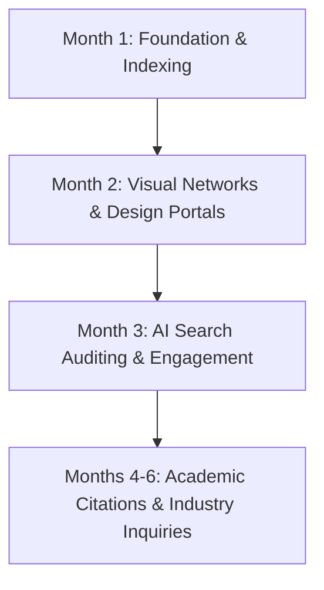

# Monthly SEO, GEO & Off-Page Authority Action Plan
**Entity:** Aanya Jain | Interior & Industrial Design Portfolio  
**Domain:** `https://aanya-interior-portfolio.vercel.app/`  
**Execution Cycle:** 6-Month Structured Growth Plan  

---

## 1. Guiding Principles & Code of Ethics

Building sustainable digital authority for a design student requires authentic creative provenance, not spam tactics:
- **Zero Black-Hat or Paid Links:** Never purchase backlinks, link packages, or PBN (Private Blog Network) placements.
- **Zero Fake Profiles:** Never register fictitious business listings, fake client reviews, or manufactured awards.
- **Topical Relevance First:** All outreach, portfolios, and social profiles must center on verified academic design: interior space planning, ergonomic furniture, passive cooling, and 3D architectural rendering.

---

## 2. Six-Month Phased Action Roadmap

---

### Month 1: Indexation Verification & Cross-Platform Synchronization
**Primary Goal:** Complete search engine verification and align public creative profiles.

- **Tasks:**
  1. Complete Google Search Console verification via HTML meta tag or DNS TXT record.
  2. Submit `https://aanya-interior-portfolio.vercel.app/sitemap.xml` in GSC.
  3. Perform manual URL inspection for the Homepage and all 6 individual project URLs to kickstart fast indexing.
  4. Synchronize professional biography across personal channels (LinkedIn, Instagram, YouTube):
     > *"Interior & Industrial Design Student at Banasthali Vidyapith (Top 20%). Focusing on sustainable spatial design, ergonomic furniture, and 3D visualization. Portfolio: https://aanya-interior-portfolio.vercel.app/"*
  5. Add canonical portfolio link to LinkedIn header, Instagram bio, and YouTube channel description (`@adorablekanya`).

---

### Month 2: Visual Search & Creative Portfolio Ecosystems
**Primary Goal:** Build high-authority creative signals on Google Images, Behance, and Pinterest.

- **Tasks:**
  1. **Behance Case Studies:** Publish high-resolution project boards for **Worker’s Module**, **Tide & Terra**, and **Dining Chair** on Behance, linking back to the exact project case study URLs on the website.
  2. **Pinterest Architectural Boards:** Create design boards centered on:
     - *Sustainable Passive Cooling Architecture* (Pinning Shulabh jaali renders)
     - *Ergonomic Dining Furniture & Joinery* (Pinning Dining Chair technical drawings)
     - *Rooftop Hospitality Lounge Design* (Pinning Tide & Terra sunset renders)
     - Include full descriptive captions and direct links to `/projects/...`.
  3. **Google Images Inspection:** Check Google Image search results for queries like `"Aanya Jain interior design"`, `"Worker's module Bagru site analysis"`, and `"Tide and Terra rooftop cafe"`.

---

### Month 3: Generative AI (GEO) Testing & Direct Citation Verification
**Primary Goal:** Evaluate how AI search engines synthesize Aanya's identity and capabilities.

- **Tasks:**
  1. **Run Diagnostic AI Search Prompts across Platforms:**
     - *Perplexity AI:* "Who is Aanya Jain in interior design?"
     - *Google Search (AI Overview):* "Aanya Jain Banasthali Vidyapith portfolio"
     - *ChatGPT / SearchGPT:* "Worker's module Bagru shelter case study"
     - *Gemini:* "Show interior design projects by Aanya Jain"
  2. **Audit AI Extraction:**
     - Verify that the AI identifies Aanya as a 7th-semester student at Banasthali Vidyapith.
     - Confirm that her specialization in sustainable spatial and ergonomic furniture design is cited.
     - Check whether `llms.txt` or individual case study URLs are referenced as citations.
  3. **Refine `/llms.txt`:** If any AI hallucination or outdated semester detail is detected, update `/public/llms.txt` and `/public/llms-full.txt` with clearer factual assertions.

---

### Month 4: Academic Outreach, Workshop Showcase & Institutional Footprint
**Primary Goal:** Deepen authoritative academic backlinks.

- **Tasks:**
  1. **IIT Delhi & IIT Bombay Workshop Showcases:**
     - Publish a dedicated LinkedIn article reflecting on technical takeaways from the *IIT Delhi Interior Design Basics Workshop* and *IIT Bombay AutoCAD Workshop*.
     - Link directly to the `/certifications` section and individual case studies where AutoCAD was utilized.
  2. **Department of Design Showcases:**
     - Ensure Aanya's student profile on Banasthali Vidyapith’s annual exhibition roster or department publications references her portfolio URL.
  3. **Design Student Forums:**
     - Participate in architecture and interior design discussions on platforms like ArchDaily, Dezeen student showcases, or Reddit design communities (`r/InteriorDesign`, `r/IndustrialDesign`), providing thoughtful commentary with references to modular or barrier-free design principles.

---

### Month 5: Conversion Rate & User Engagement Optimization
**Primary Goal:** Optimize lead generation and internship inquiries.

- **Tasks:**
  1. **Google Analytics 4 Review:**
     - Analyze top traffic sources (Organic Search, LinkedIn, Direct, Image Search).
     - Identify which project pages have the highest average engagement time and lowest bounce rate.
     - Measure total resume PDF downloads and email clicks.
  2. **CTA Refinements:**
     - If one project attracts significantly higher recruiter interest (e.g., Tide & Terra or Universal Toilet), feature that project prominently in email signatures and outreach materials.
  3. **Resume Updates:**
     - When academic semester milestones occur (e.g., moving into 8th semester or completing the degree in 2027), update `Aanya-Jain-Resume.pdf` and sync dates across all 6 project case studies.

---

### Month 6: Comprehensive Semi-Annual Audit & Strategic Evolution
**Primary Goal:** Quantify organic growth and plan the post-graduation professional transition.

- **Tasks:**
  1. **Search Console Benchmarking:**
     - Total Impressions (Target: 1,500+ monthly impressions).
     - Total Clicks (Target: 100+ qualified clicks from design recruiters and studios).
     - Average Position for branded queries (`Aanya Jain portfolio` in top 3).
  2. **Indexing Health:**
     - Confirm 100% clean indexation with zero 404 or 500 errors.
  3. **Graduation Transition Plan (2027):**
     - Transition designation from *Interior & Industrial Design Student* to *Interior & Industrial Designer / Spatial Strategist*.
     - Evaluate custom domain migration (e.g., `aanyajain.design`) with 301 redirects from the Vercel subdomain.
