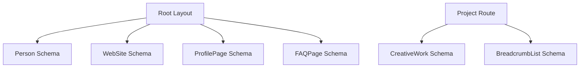

# Technical SEO, GEO & AEO Implementation Report
**Website:** `https://aanya-interior-portfolio.vercel.app/`  
**Date of Completion:** 16 November 2026  
**Implementation Lead:** Senior Frontend Engineer & Search Optimization Specialist  

---

## 1. Overview of Delivered Enhancements

This report details the concrete codebase modifications implemented to transform Aanya Jain's interior and industrial design portfolio into a high-visibility, search-engine-accessible, and AI-discoverable digital platform.

All updates were engineered directly within the existing Next.js 15 repository while preserving the warm beige, sage-green, and editorial visual language.

---

## 2. Route Architecture & Static Page Generation

Prior to this implementation, the website operated as a single-page app where all case study details were trapped inside client modals. The portfolio now boasts **7 statically prerendered routes** with automatic sitemap discovery:

| Route Path | Type | HTTP Status | Prerender Mode | Purpose |
| :--- | :--- | :--- | :--- | :--- |
| `/` | Page | `200 OK` | Static (SSG) | Main Homepage with Hero, CV, Certifications, Work, Skills, FAQ, Contact |
| `/projects/workers-module-bagru` | Page | `200 OK` | Static (SSG) | Full 17-point case study on Bagru modular construction shelter |
| `/projects/centre-table-furniture-design` | Page | `200 OK` | Static (SSG) | Full 17-point case study on space-saving nesting centre table |
| `/projects/tide-and-terra-rooftop-cafe-pune` | Page | `200 OK` | Static (SSG) | Full 17-point case study on Kothrud rooftop hospitality lounge |
| `/projects/universal-toilet-accessible-design` | Page | `200 OK` | Static (SSG) | Full 17-point case study on MoHUA barrier-free sanitation facility |
| `/projects/shulabh-residential-interior-ahmedabad` | Page | `200 OK` | Static (SSG) | Full 17-point case study on Ahmedabad passive cooling residence |
| `/projects/dining-chair-furniture-design` | Page | `200 OK` | Static (SSG) | Full 17-point case study on sculpted ergonomic hardwood chair |
| `/sitemap.xml` | Route | `200 OK` | Dynamic XML | Automatic Google XML sitemap with image namespace |
| `/robots.txt` | Route | `200 OK` | Dynamic TXT | Bot crawling directives and sitemap pointer |
| `/llms.txt` | Static | `200 OK` | Plaintext | Standardized AI/LLM search engine knowledge manifest |
| `/llms-full.txt` | Static | `200 OK` | Plaintext | In-depth technical case study documentation for AI scrapers |

---

## 3. Metadata Matrix

Each page now has unique, keyword-optimized titles, meta descriptions, canonical URLs, and OpenGraph social cards:

### 3.1 Homepage
- **Title:** `Aanya Jain | Interior & Industrial Design Portfolio`
- **Meta Description:** `Explore Aanya Jain's interior and industrial design portfolio featuring sustainable spatial design, furniture concepts, ergonomic solutions, 3D visualization and creative design projects.`
- **Canonical:** `https://aanya-interior-portfolio.vercel.app/`
- **OG Image:** `/images/aanya-jain-interior-designer-agra-portrait.webp` (1200 × 630)

### 3.2 Individual Project Pages
1. **Worker’s Module**
   - **Canonical:** `https://aanya-interior-portfolio.vercel.app/projects/workers-module-bagru`
   - **Title:** `Worker’s Module | Sustainable Spatial Design in Bagru | Aanya Jain`
   - **Meta Description:** `Explore Aanya Jain's Worker’s Module case study: a sustainable modular shelter proposal addressing climatic conditions and worker welfare in Bagru, Rajasthan.`
   - **OG Image:** `/images/aanya-jain-worker-module-bagru-spatial-design.webp`
2. **Centre Table**
   - **Canonical:** `https://aanya-interior-portfolio.vercel.app/projects/centre-table-furniture-design`
   - **Title:** `Centre Table with Nesting Stools | Ergonomic Furniture Design | Aanya Jain`
   - **Meta Description:** `Discover Aanya Jain's space-saving Centre Table with four concealed nesting stools, exploring bent tubular metal frames and slatted timber surfaces.`
   - **OG Image:** `/images/aanya-jain-centre-table-furniture-design.webp`
3. **Tide & Terra**
   - **Canonical:** `https://aanya-interior-portfolio.vercel.app/projects/tide-and-terra-rooftop-cafe-pune`
   - **Title:** `Tide & Terra Rooftop Café | Hospitality Spatial Design Pune | Aanya Jain`
   - **Meta Description:** `Explore Tide & Terra by Aanya Jain: a rooftop hospitality concept in Kothrud, Pune, balancing subterranean cave-like alcoves with open panoramic sky decks.`
   - **OG Image:** `/images/aanya-jain-tide-terra-rooftop-cafe-pune.webp`
4. **Universal Toilet**
   - **Canonical:** `https://aanya-interior-portfolio.vercel.app/projects/universal-toilet-accessible-design`
   - **Title:** `Universal Toilet | Barrier-Free Accessible Design | Aanya Jain`
   - **Meta Description:** `Discover Aanya Jain's Universal Toilet institutional case study: an accessible 364 sq.ft. restroom designed per MoHUA Barrier-Free Guidelines at Banasthali Vidyapith.`
   - **OG Image:** `/images/aanya-jain-universal-accessible-toilet-design.webp`
5. **Shulabh**
   - **Canonical:** `https://aanya-interior-portfolio.vercel.app/projects/shulabh-residential-interior-ahmedabad`
   - **Title:** `Shulabh Residential Interior | Sustainable Passive Living Ahmedabad | Aanya Jain`
   - **Meta Description:** `Explore Shulabh by Aanya Jain: a residential interior concept in Ahmedabad, Gujarat, utilizing terracotta jaali screens, Kota stone, and passive cooling.`
   - **OG Image:** `/images/aanya-jain-shulabh-residential-interior-ahmedabad.webp`
6. **Dining Chair**
   - **Canonical:** `https://aanya-interior-portfolio.vercel.app/projects/dining-chair-furniture-design`
   - **Title:** `Dining Chair | Ergonomic Hardwood Furniture Design | Aanya Jain`
   - **Meta Description:** `Discover Aanya Jain's Dining Chair case study: an exploration of 'Protection & Openness' featuring sculpted hardwood, curved cabriole legs, and woven cord backrest.`
   - **OG Image:** `/images/aanya-jain-dining-chair-furniture-design.webp`

---

## 4. Structured Data (JSON-LD) Implementations

All structured data was crafted strictly conforming to Schema.org standards without fabricating business metrics:

### 4.1 Root Schemas (`app/layout.tsx`)
- **`Person`:** Identifies Aanya Jain, her student status at Banasthali Vidyapith, Agra address, verified contact channels (email, telephone), and sameAs links (Heyzine flipbook, YouTube, Instagram).
- **`WebSite`:** Encapsulates the portfolio domain, site name, and publisher entity link.
- **`ProfilePage`:** Formal Schema.org classification for professional creative student portfolios.
- **`FAQPage`:** Maps all 10 verified question-and-answer pairs for search engine accordion rich results.

### 4.2 Project Schemas (`app/projects/[slug]/page.tsx`)
- **`CreativeWork`:** Declares project title, author, genre (`Spatial Design` vs `Furniture Design`), location created (`Bagru`, `Ahmedabad`, `Pune`, `Banasthali`), year, image, and keyword tags.
- **`BreadcrumbList`:** Establishes a 3-tier hierarchy: `Home` → `Projects` → `[Project Title]`.

---

## 5. Components & User Experience Upgrades

### 5.1 Project Card Dual Action (`components/ProjectCard.tsx`)
- The card title is now a semantic, crawlable link (`<Link href="...">`).
- The image thumbnail opens the instant interactive modal for fast desktop browsing.
- The footer provides dual controls: **Quick View** (modal preview) and **Case Study ↗** (direct link to dedicated URL).

### 5.2 17-Point Project Case Study Template (`app/projects/[slug]/page.tsx`)
Includes dedicated editorial modules for all 17 required criteria:
1. Project Name & Header Banner
2. Project Category Tag
3. Project Geographic Location
4. Academic Semester & Year
5. Design Brief Card
6. Problem Statement Card
7. Research & Climatic Observations List
8. 4 Formatted Design Objectives
9. Concept Development Narrative
10. Moodboard & Vernacular Inspiration
11. Space Planning & Zoning Breakdown
12. Material Selection & Specifications
13. Furniture & Lighting Considerations
14. AutoCAD Technical Drawings Grid
15. 3D Architectural Visualizations
16. Final Design Outcome & Highlights Box
17. Aanya's Specific Role & Academic Contribution

### 5.3 Interactive FAQ Accordion (`components/FaqSection.tsx`)
- Fully accessible accordion with `aria-expanded` and `aria-controls`.
- Category filter pills (`All`, `Identity & Background`, `Design Concepts`, `Portfolio & Collaboration`).
- 40–80 word direct, factual answers.
- Contextual deep-links leading into relevant portfolio sections.

### 5.4 High-Resolution Image Lightbox (`components/ProjectImageViewer.tsx`)
- Fullscreen zoom overlay with smooth Framer Motion transitions.
- Supports high-resolution viewing of detailed architectural drawings and 3D renders on mobile and desktop.

---

## 6. Verification and Validation Results

- **Next.js Production Build:** `next build` executed with **0 errors**, confirming valid TypeScript types and successful static prerendering of all routes.
- **Local HTTP Endpoint Verification:**
  - `curl -I http://localhost:3000/robots.txt` → `200 OK (text/plain)`
  - `curl -I http://localhost:3000/sitemap.xml` → `200 OK (application/xml)`
  - `curl -I http://localhost:3000/llms.txt` → `200 OK (text/plain)`
  - `curl -I http://localhost:3000/projects/workers-module-bagru` → `200 OK (text/html)`
- **HTML Semantic Hierarchy:** Verified exactly one `<h1>` per page, followed by logical `<h2>` and `<h3>` tags.
